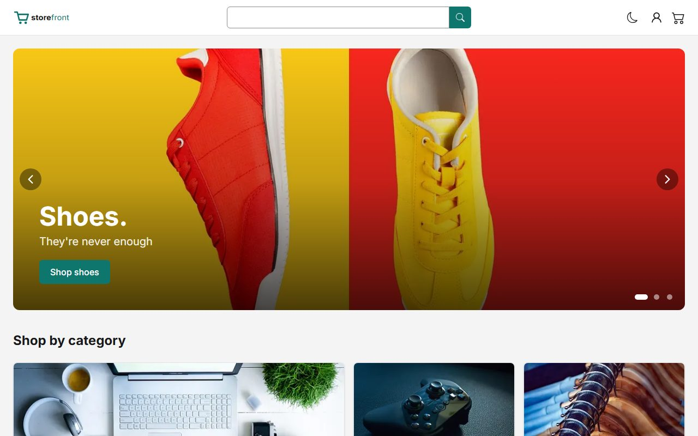
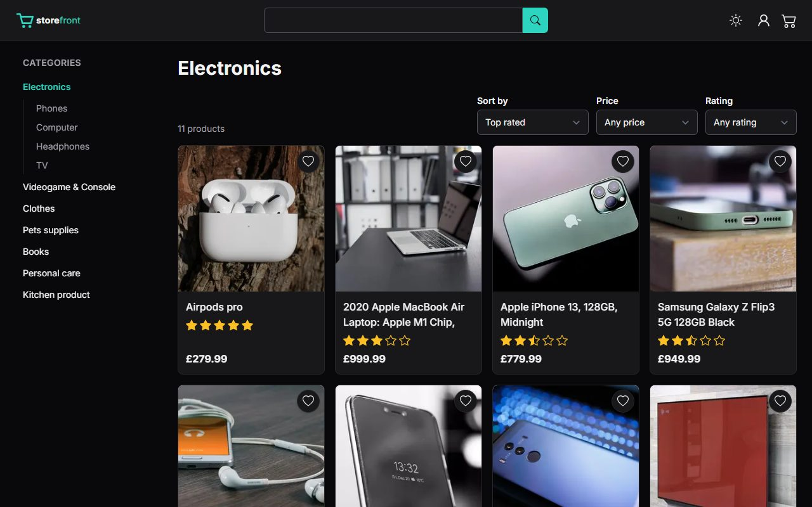
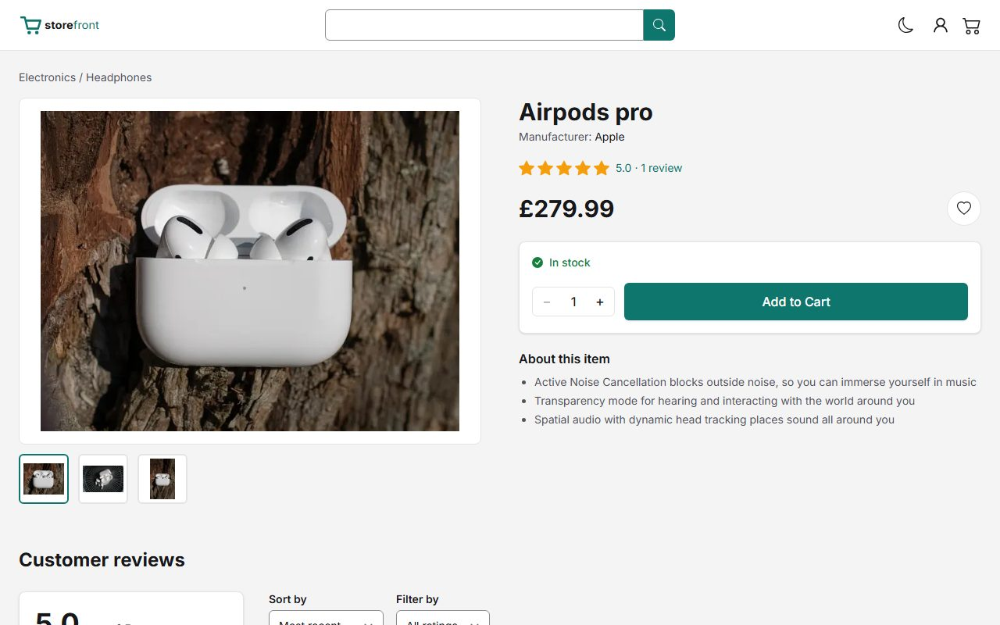
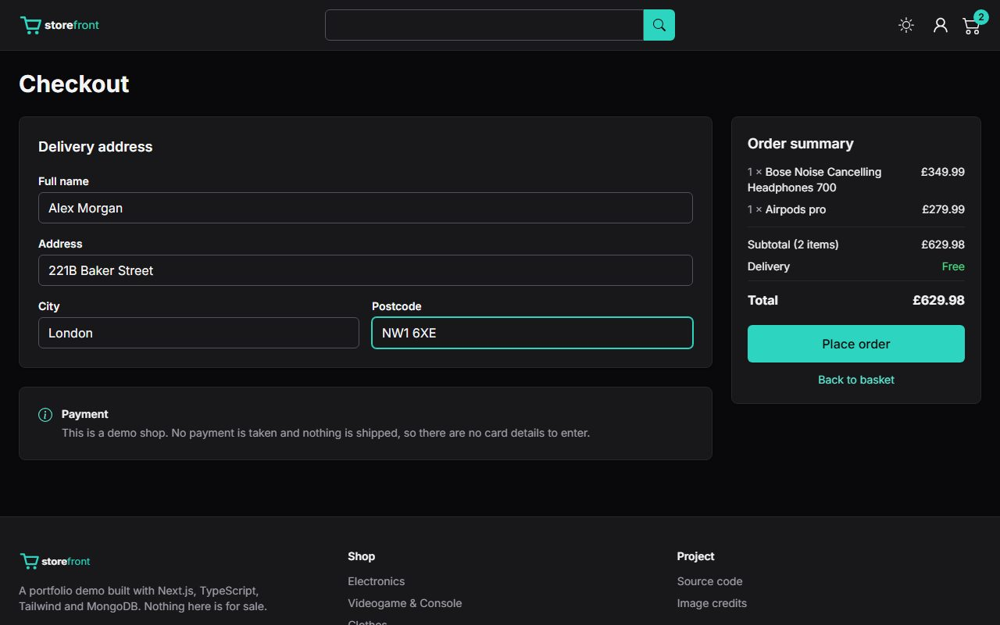
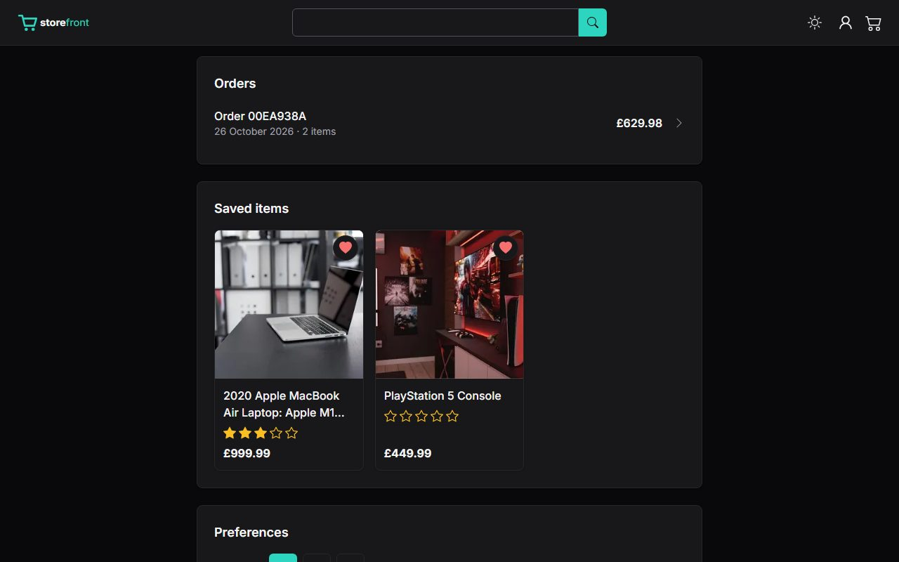

# Storefront

A demo online shop built with Next.js, TypeScript, Tailwind and MongoDB.

**[Live demo](https://glc-storefront.vercel.app/)**: use **Try the demo account** on the sign-in page. Nothing is charged or shipped.

## Features

- Search with suggestions, category pages with sort and filters
- Product pages with gallery, reviews, and "More like this"
- Basket, demo checkout and order history
- Wishlist and recently viewed products
- Light and dark themes, responsive down to 320px
- £, $ or € prices
- Accessible: WCAG 2.1 AA checked with axe

| Category (dark)                                 | Product                                       |
| ----------------------------------------------- | --------------------------------------------- |
|  |  |
| **Checkout (dark)**                             | **Profile (dark)**                            |
|  |  |

## Stack

Next.js 16, React 19, TypeScript, Tailwind CSS 4, MongoDB with Mongoose, TanStack Query, React Hook Form with Zod, JWT auth, Playwright and axe tests, GitHub Actions and Vercel.

## Local setup

Requires Node 22 and access to the MongoDB cluster.

1. `npm install`
2. Create `.env.local` with `MONGO_URI` (a database ending in `-dev`), `PROD_MONGO_URI`, `ACCESS_TOKEN_SECRET` and `TEST_PASSWORD`.
3. `npm run db:reset` to seed the dev database from production.
4. `npm run dev` and open http://localhost:3000

Run the tests with `npm run test:e2e` (first time: `npx playwright install chromium`).

Photo credits are in [IMAGE_CREDITS.md](IMAGE_CREDITS.md).
